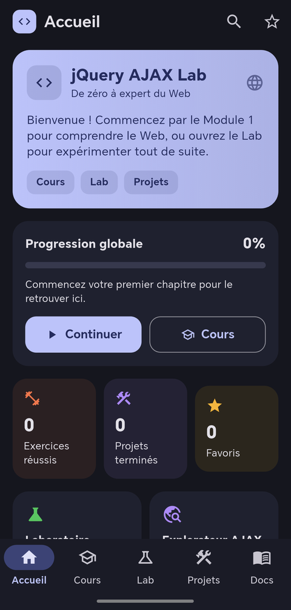
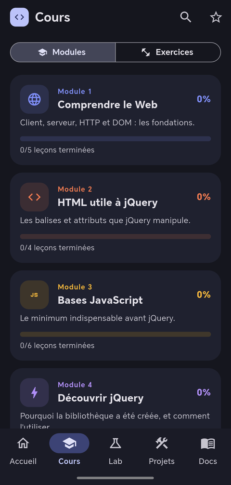
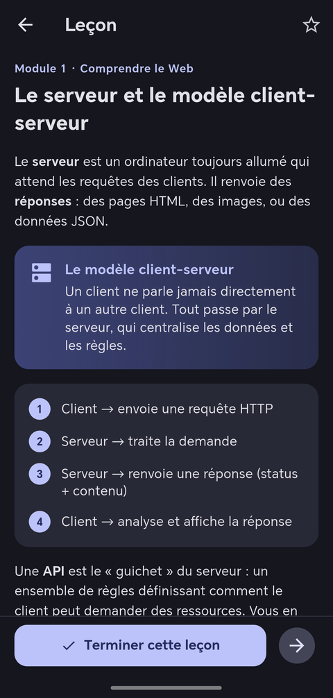
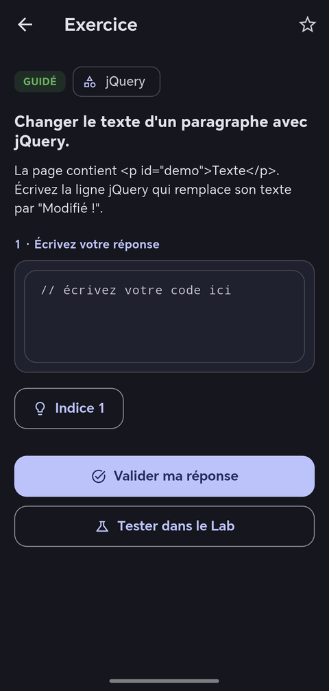
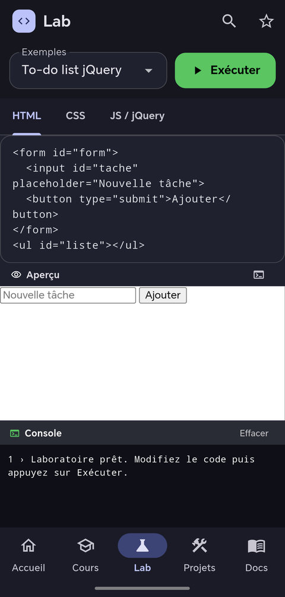
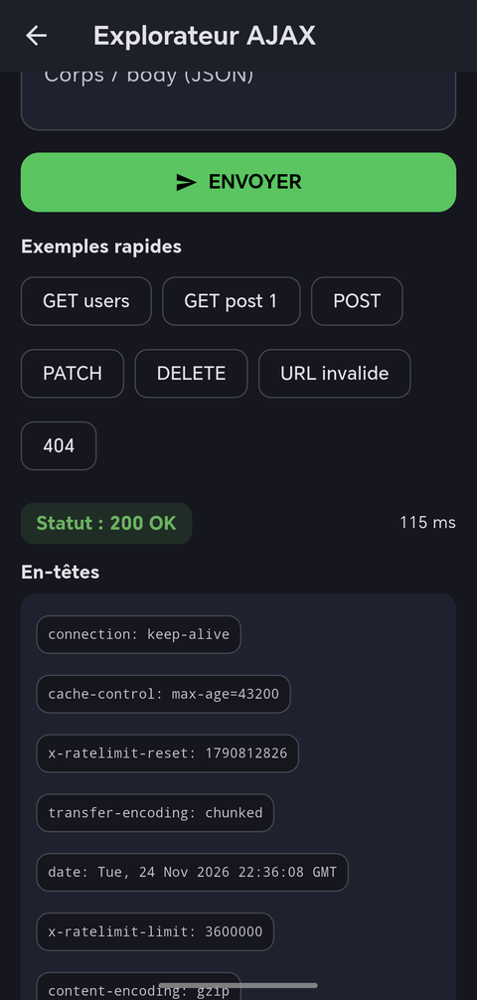
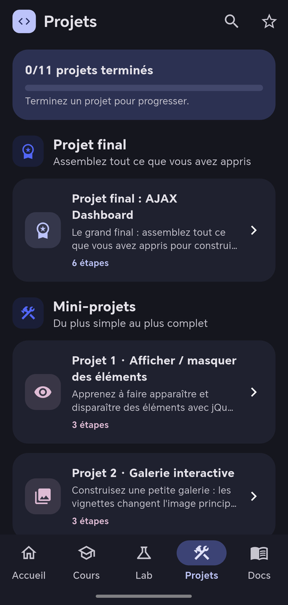
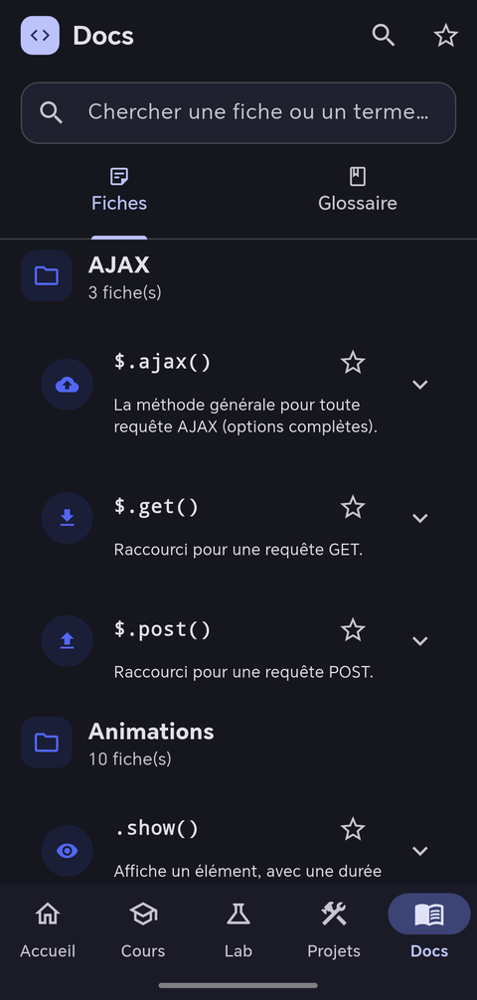
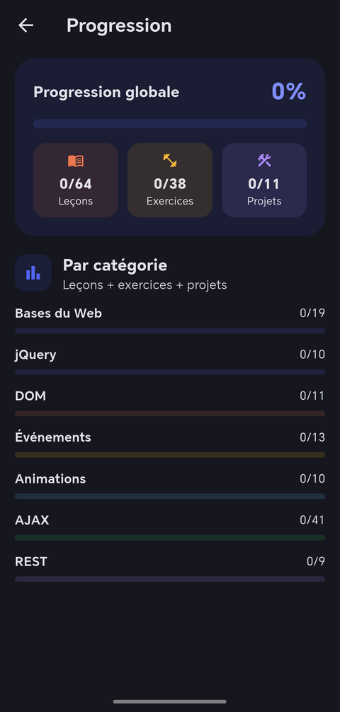

# jQuery AJAX Lab

Application Android pédagogique (Flutter) pour apprendre le **Web, HTML/CSS/JS, jQuery, le DOM, les événements, les animations, l'AJAX, le HTTP, le JSON et les API REST** : cours hors-ligne, exercices interactifs, mini-projets guidés, laboratoire de code avec aperçu en direct, explorateur de requêtes HTTP, fiches de référence, progression et favoris.



## Fonctionnalités

- **5 onglets** : Accueil · Cours · Lab · Projets · Docs
- **3 modules de cours** (20+ sections) : Fondations du Web, jQuery, AJAX & REST — contenus hors-ligne (HTML/CSS/JS, DOM, sélecteurs, événements, animations, `$.ajax`, fetch/async-await, JSON, REST)
- **Exercices interactifs** (10+) : GUIDÉ / SEMI-GUIDÉ / AUTONOME, QCM ou code, indices progressifs (Indice 1 → Indice 2 → solution), validation pédagogique (jamais de simple « FAUX »)
- **Explorateur AJAX** : mini-Postman (GET/POST/PUT/PATCH/DELETE, en-têtes, corps, exemples, gestion des erreurs, vue brute + jolie du JSON)
- **Laboratoire** : éditeurs HTML/CSS/JS, console, aperçu WebView en direct avec **jQuery 3.7.1 embarqué**, exemples prêts à lancer
- **Projets** (10+) : étapes guidées, indices, solutions et code final, dont le projet final « Tableau de bord AJAX »
- **Docs** : fiches de référence, aide-mémoire jQuery, glossaire (plus de 20 entrées), recherche globale
- **Explique-moi ce code** : sélectionnez du code, obtenez une explication pédagogique
- **Progression** globale et par catégorie, **favoris**, réglages (thème clair/sombre, taille du texte), mode d'emploi

## Captures d'écran

| Écran | Capture |
| --- | --- |
| Accueil |  |
| Liste des cours |  |
| Déroulé d'un cours |  |
| Exercice |  |
| Laboratoire |  |
| Explorateur AJAX |  |
| Projets |  |
| Docs |  |
| Progression |  |

## Démarrage

Prérequis : Flutter (3.x) et un SDK Android configurés.

```bash
flutter pub get
flutter run            # sur un appareil/émulateur connecté
```

### Qualité du code

```bash
flutter analyze        # aucun problème attendu
flutter test           # 97 tests (données, validation, HTTP, widgets, lab)
```

### Construire l'APK de production

```bash
flutter build apk --release
# → build/app/outputs/flutter-apk/app-release.apk
```

## Structure du projet

```
lib/
├── app/          # point d'entrée, shell (navigation), thème (Material 3)
├── core/         # constantes et citations
├── data/         # données pédagogiques (cours, exercices, projets, exemples, docs, glossaire)
├── models/       # modèles (Exercise, ContentBlock, Project, Snippet, …)
├── screens/      # 15 écrans
├── services/     # persistance (progression, favoris, réglages), HTTP, moteur du lab
├── utils/        # explication de code, helpers
└── widgets/      # composants réutilisables (blocs de cours, vue de code, kit)
assets/           # jQuery 3.7.1 embarqué
test/             # tests unitaires et de widgets
```

## Technologies

- **Flutter / Dart** — Material 3, thème clair + sombre, animations
- **webview_flutter** — aperçu en direct du laboratoire
- **shared_preferences** — persistance locale (progression, favoris, réglages)
- **package:http** — appels HTTP réels (API publiques), mockés en test
- **jQuery 3.7.1** — bibliothèque embarquée dans le laboratoire (hors-ligne)
